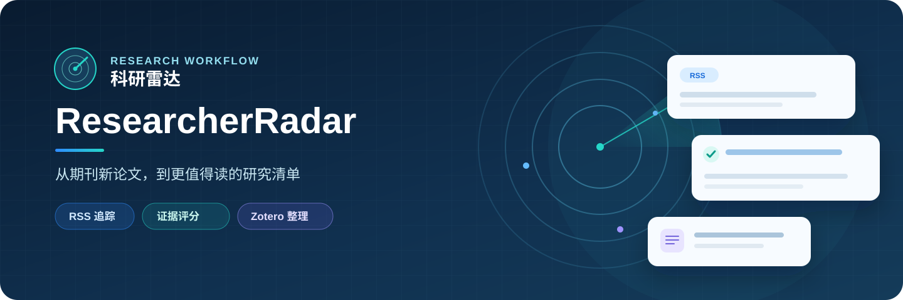
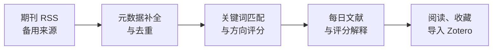

<p align="center">
  
</p>

<h1 align="center">科研雷达 · ResearcherRadar</h1>

<p align="center">把每天的新论文，整理成更接近你研究方向的阅读清单。</p>

<p align="center">
  
  
  
  
</p>

<p align="center">
  <a href="#功能亮点">功能亮点</a> ·
  <a href="#工作流程">工作流程</a> ·
  <a href="#快速开始">快速开始</a> ·
  <a href="#文档">文档</a>
</p>

科研雷达是一套可自行部署的文献追踪系统。它从你关注的期刊收集新论文，按研究方向和关键词给出**可解释的推荐分**，再由你决定阅读、收藏或导入 Zotero。它适合需要每天跟踪多个期刊，却不想反复浏览大量无关条目的研究者。

## 功能亮点

| 🔭 追踪期刊 | 🎯 解释推荐 | 📚 整理文献 |
| :--- | :--- | :--- |
| 管理 RSS 来源，并在主来源异常时使用 OpenAlex、Crossref 等备用来源。 | 在标题、摘要和 RSS 关键词中匹配完整英文词；支持权重、同义词和排除词。 | 按日期查看论文，筛选、收藏，并导入 Zotero Collection。 |

| 🧭 研究方向 | 🧹 去重与反馈 | ✨ 按需速读 |
| :--- | :--- | :--- |
| 为方向设置研究相关度和关注优先级；前者参与受限加分，后者辅助排序。 | 按 DOI、URL 和规范化标题去重；“不相关”将文章置为 0 分，同时保留去重记录。 | 配置 AI 接口后，手动根据论文标题和原始摘要生成速读。 |

**推荐分有据可查。** 论文详情会显示命中的关键词、所在字段、权重和分数贡献。期刊名不会单独形成推荐证据，方向奖励也不能代替关键词命中。你可以调整规则并重新计算已有论文的分数。

## 工作流程



Zotero 同步和 AI 速读是可选功能。没有配置 API Key，也可以使用 RSS 抓取、评分和日报。系统不会自动将文献推送到外部服务；导入 Zotero 和 AI 速读都由你在页面中触发。

## 快速开始

需要 **Python 3.11+**、**Node.js 18+** 和 npm。下面以 Windows PowerShell 为例；Linux 和服务器部署步骤见[完整技术手册](TECHNICAL_GUIDE.md)。

**1. 启动后端。** 在准备放置项目的目录运行：

```powershell
git clone https://github.com/zhengnan365/Researcher-Radar.git
cd researcher-radar\backend
py -3.11 -m venv .venv
.\.venv\Scripts\python.exe -m pip install -r requirements.txt
.\.venv\Scripts\python.exe manage.py migrate
.\.venv\Scripts\python.exe manage.py createsuperuser
.\.venv\Scripts\python.exe manage.py runserver 127.0.0.1:8000
```

**2. 启动前端。** 另开一个 PowerShell 窗口，从执行 `git clone` 的目录运行：

```powershell
cd researcher-radar\frontend
npm.cmd install
npm.cmd run dev
```

打开 **<http://127.0.0.1:5173>**，使用刚创建的账号登录。系统**没有默认账号或默认密码**，也不会自动导入演示文献；首次使用请添加研究方向、关键词和期刊来源。

### 服务器部署

- **首次部署**：运行部署向导时设置自己的管理员用户名和密码，再配置域名、数据库与定时任务。
- **增量部署**：保留现有账号、数据库和 API 配置，不需要重新设置密码。
- 正式部署需设置独立的 `DJANGO_SECRET_KEY`、允许访问的域名和 HTTPS。配置示例见 [.env.example](.env.example)，操作见[首次与增量部署指南](docs/DEPLOY_FIRST_INCREMENTAL.md)。

不要把 `.env`、数据库、API Key 或配置导出文件提交到 Git。配置导出文件包含敏感 Key，应当作为私有备份保存。

## 技术组成

`Django + Django REST Framework` 提供抓取、评分和 API；`Vue 3 + Vite + Element Plus` 提供网页界面；默认使用 SQLite 存储。文献来源包括 RSS、OpenAlex 和 Crossref，可选连接 Zotero、Semantic Scholar、Elsevier 及兼容接口的 AI 服务。

## 文档

- [完整技术手册：功能、配置、接口与运维](TECHNICAL_GUIDE.md)
- [首次部署与增量更新](docs/DEPLOY_FIRST_INCREMENTAL.md)
- [宝塔部署](docs/DEPLOY_BAOTA.md)
- [研究方向与关键词粘贴示例](docs/import_examples/README.md)

## 开源协议

本项目采用 [GNU Affero General Public License v3.0](LICENSE)。修改版通过网络向用户提供服务时，也需要按协议向这些用户提供相应源码。
